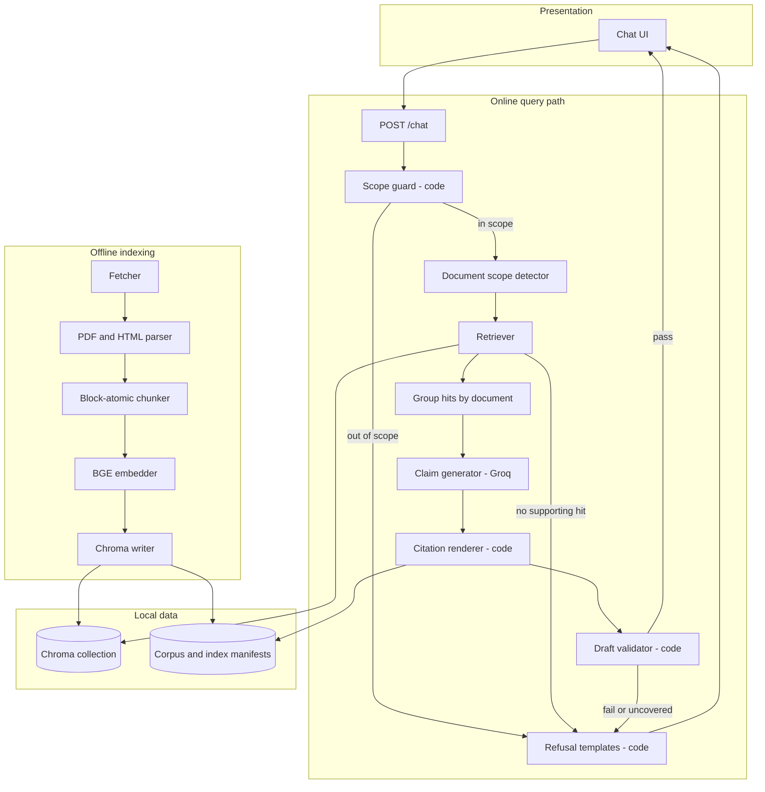
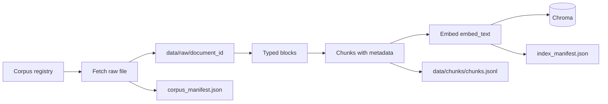
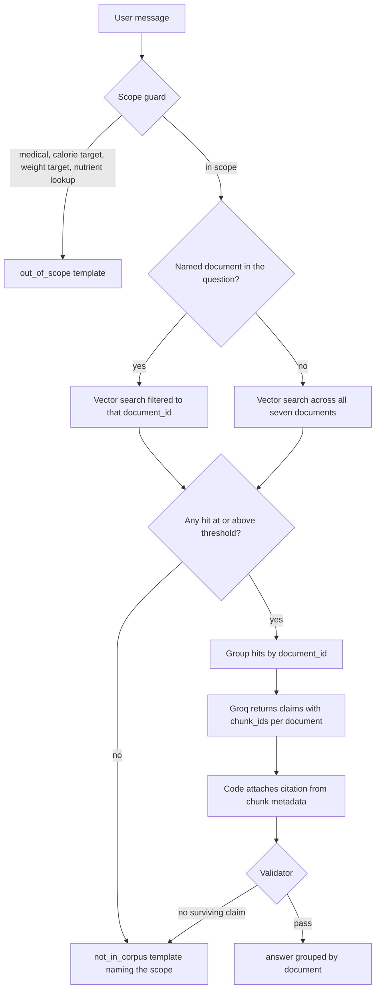

# Architecture: Dietary Guidance RAG Chatbot

This document describes the system architecture for the prototype in [problemStatement.md](./problemStatement.md). The assistant answers questions about food, nutrition, and food safety from seven official public guidance documents. Every claim is cited. Questions the guidance does not cover, and questions that are out of scope by design, are declined by code.

**Stack, continued from the previous milestone:** Python application · **Groq** for answer text · **BGE** (`BAAI/bge-small-en-v1.5`) for local embeddings · **Chroma** for the vector index. Scope limits are a rule-based guard that runs before retrieval and before any model call, with a second check on the draft before it is returned.

---

## 1. Design principles

| Principle | What the architecture does with it |
| --- | --- |
| Groundedness | The model sees only retrieved chunk text. Citations are filled from chunk metadata by application code. |
| Traceability | Each claim is stored with the chunk ids it came from. The rendered citation is document name, publisher, year, and source URL. |
| Source integrity | Hits are grouped by document. The model writes one section per document. A claim may cite only one document. |
| Safety by construction | Medical advice, personal calorie targets, personal weight targets, and per-food nutrient lookups are refused by a code classifier. The generator is never called for those queries. |
| Right data, right place | The index contains prose and tables from the seven guidance documents. Per-food nutrient figures are excluded from ingestion and from answers. |

---

## 2. Corpus

The index is built only from the seven documents in problem statement §3.1. A corpus registry in code is the allowlist for fetch, citation, and “what was searched”.

| `document_id` | Document | Publisher | Year | Kind | Source URL |
| --- | --- | --- | --- | --- | --- |
| `cold-food-storage` | Cold Food Storage Chart | FoodSafety.gov (HHS / FDA / USDA) | 2023 | Food safety, mostly a table | https://www.foodsafety.gov/food-safety-charts/cold-food-storage-charts |
| `who-healthy-diet` | Healthy diet (Fact sheet) | World Health Organization | 2018 | Nutrition | https://www.who.int/docs/default-source/healthy-diet/healthy-diet-fact-sheet-394.pdf |
| `fao-who-healthy-diets` | What are healthy diets? Joint statement | FAO and WHO | 2024 | Nutrition | https://www.who.int/publications/i/item/9789240101876 |
| `who-five-keys` | Five keys to safer food manual | World Health Organization | 2006 | Food safety | https://www.who.int/publications/i/item/9789241594639 |
| `eatwell-guide` | The Eatwell Guide booklet | Public Health England (now OHID) | 2018 | Nutrition | https://assets.publishing.service.gov.uk/media/5ba8a50540f0b605084c9501/Eatwell_Guide_booklet_2018v4.pdf |
| `fsa-chill` | How to chill, freeze and defrost food safely | Food Standards Agency (UK) | 2017 | Food safety | https://www.gov.uk/government/publications/how-to-chill-freeze-and-defrost-food-safely/how-to-chill-freeze-and-defrost-food-safely |
| `kitchen-companion` | Kitchen Companion: Your Safe Food Handbook | USDA Food Safety and Inspection Service | 2008 | Food safety | https://www.fsis.usda.gov/sites/default/files/media_file/2020-12/Kitchen-Companion.pdf |

Each registry entry also stores `retrieval_date`, filled when that file is downloaded, and a list of `aliases` used to detect “answer from this document” (for example `eatwell`, `eatwell guide`, `kitchen companion`, `five keys`).

`cold-food-storage`, `fsa-chill`, and the WHO publication pages are HTML. The other entries are PDFs. Several hosts return 403 to clients that do not send a browser User-Agent, so the fetcher sends one and saves the raw bytes next to a manifest row.

---

## 3. High-level architecture



Two paths:

1. **Offline indexing** runs when the corpus is built or refreshed. It does not run on the user request path.
2. **Online answering** classifies the question in code, retrieves, asks the model for claims tied to chunk ids, then renders citations and checks the draft in code.

---

## 4. Offline indexing pipeline



### 4.1 Fetch

For each registry row the fetcher:

1. Downloads the URL with a browser User-Agent.
2. Writes the bytes to `data/raw/<document_id>/source.<pdf|html>`.
3. Records `retrieval_date` (UTC date), content hash, HTTP status, and final URL after redirects in `data/corpus_manifest.json`.

A row is skipped on a later run when the hash is unchanged. A failed download leaves the previous file in place and marks the row `stale` so the index is not silently built from a partial corpus.

### 4.2 Parse into typed blocks

The parser emits a sequence of blocks. A block has a type, text, and the heading path above it.

| Block type | Produced from | Rule |
| --- | --- | --- |
| `heading` | PDF outline / font size, HTML `h1`–`h3` | Updates the heading path. Not itself a retrieval chunk. |
| `paragraph` | Body prose | Kept whole. |
| `list_item` | Numbered or bulleted recommendation | Kept whole, including its number. |
| `table` | PDF table extraction or HTML `<table>` | Kept as a markdown table. Header row stored separately so it can be repeated onto each row chunk. |

PDF text and PDF tables are extracted separately (text layer plus a table extractor). Reading-order text that is only the flattened table is dropped, so the same grid is not indexed twice. HTML pages (`cold-food-storage`, `fsa-chill`, and publication landing pages) use the same block types. Boilerplate (cookie banners, “is this page useful”, nav) is stripped before chunking.

The Cold Food Storage Chart is one table: food, type, refrigerator time, freezer time. Each data row becomes a block whose text includes the column headers, for example:

```text
Food: Poultry | Type: Chicken or turkey, whole | Refrigerator (40°F / 4°C or below): 1 to 2 days | Freezer (0°F / -18°C or below): 1 year
```

That row is the unit a question like “how long can I keep a whole chicken in the fridge” must retrieve intact.

### 4.3 Chunking

**Chosen strategy: block-atomic chunks under a heading.**

A chunk is exactly one of:

- one `list_item` (a numbered recommendation stays with its number and its section heading)
- one table row, with the header line included in the chunk text
- one `paragraph`, or several short paragraphs under the same heading packed until `MAX_CHUNK_TOKENS` (target 400, hard cap 800)

A chunk is never cut in the middle of a sentence, a numbered item, or a table row. When a single paragraph exceeds the cap, it is split on sentence boundaries with a small overlap (`CHUNK_OVERLAP_TOKENS`, about 50), and both pieces keep the same heading path.

Every chunk carries:

| Field | Source |
| --- | --- |
| `chunk_id` | Stable id: `{document_id}:{ordinal}` |
| `document_id` | Registry slug |
| `document_name` | Registry document title |
| `publisher` | Registry publisher |
| `year` | Registry year |
| `source_url` | Registry URL |
| `retrieval_date` | Manifest date for that file |
| `section_heading` | Nearest heading path, joined with ` > ` |
| `block_type` | `paragraph`, `list_item`, or `table_row` |
| `text` | The text shown to the model and cited |
| `embed_text` | `"{document_name} — {section_heading}\n{text}"` |

`embed_text` is what BGE embeds. Prefixing the document name and section keeps a short row such as “1 to 2 days” from colliding with a similar row in another handbook. Filtering still uses `document_id` metadata; the prefix is only for the vector.

**What this costs** (this is the trade-off the README must state):

- Chunks are uneven. A storage-chart row is a few dozen tokens; a WHO paragraph is several hundred. Short rows embed less distinctly than a packed 500-token window, which is why the prefix and the metadata filter exist.
- The parser is document-specific enough to handle PDF tables and HTML tables. A new document format needs a parser case.
- Some heading context lives only in metadata and the prefix, so a chunk does not repeat the whole parent section.

Fixed-size token windows are rejected for this corpus because they split refrigerator/freezer columns apart and cut numbered recommendations in half.

### 4.4 Embed and index

- Model: `BAAI/bge-small-en-v1.5`, local, same query-prefix convention as the previous milestone (documents embedded as-is; queries prefixed with the BGE query instruction).
- Metric: cosine similarity on L2-normalized vectors.
- Store: one Chroma collection, persistent under `data/index/`.
- Each Chroma record stores `text` as the document body and puts `document_id`, `document_name`, `publisher`, `year`, `source_url`, `section_heading`, `block_type`, and `retrieval_date` in metadata so filtered search and citation rendering do not need a second lookup.
- `data/index/index_manifest.json` records model name, chunk count, content fingerprint, and `embedded_at`. A rebuild is skipped when the chunk fingerprint matches.

---

## 5. Online query path



### 5.1 Scope guard (code, before retrieval)

This is the same enforcement pattern as the previous milestone: deterministic rules, a fixed template, and no Groq call.

The guard runs on the raw user message. Matching any pattern below returns immediately with `type: "out_of_scope"`.

| Reason code | What it catches | Template must |
| --- | --- | --- |
| `medical` | Diagnosis, symptoms, medicines, “I have [condition]”, treatment, whether a food is safe for a stated illness | Decline, and point the person to a qualified professional |
| `calorie_target` | How many calories the person should eat, a deficit, a personal calorie goal | Decline, and point the person to a qualified professional |
| `weight_target` | What the person should weigh, an ideal weight, a personal weight goal | Decline, and point the person to a qualified professional |
| `nutrient_lookup` | Calories, protein, or other nutrient amounts in a named food | Decline. Say this assistant answers from dietary guidance documents and does not look up nutrient numbers for individual foods |

Population guidance that appears inside the documents (“limit free sugars to less than 10% of total energy intake”, “keep salt under 5 g per day”) stays in scope. Those are questions about what the guidance says, and the answer is a cited claim. The guard is aimed at a personal target or a per-food number, which is detected from the question wording before any chunk is retrieved.

The patterns live in `src/rag/classifier.py` and are covered by unit tests. A prompt instruction is not the enforcement.

### 5.2 Document scope detector

After the guard, the detector sets the retrieval scope:

- If the message names one corpus document via its aliases, `document_id` is set and retrieval is filtered to that id. The searched set reported on a miss is that one document.
- Otherwise retrieval runs across the whole collection. The searched set is all seven document names.

This is the two-mode requirement: cross-corpus search, and search restricted to one named document. The UI can also send `document_id` explicitly; an explicit id overrides alias detection.

### 5.3 Retriever

1. Embed the query with the BGE query prefix.
2. Query Chroma for the top `k` chunks (`k = 8` across the corpus, `k = 5` when filtered to one document).
3. When `document_id` is set, pass it as a Chroma metadata filter so other documents cannot appear in the hit list.
4. Drop hits below `MIN_SIMILARITY` (starting point `0.45`, tuned against the eval set).
5. If the kept list is empty, return `not_in_corpus` without calling Groq. The refusal names every document in the searched set (name, publisher, year).

Hits that survive are grouped by `document_id`. Within a document, keep at most 3 chunks. Documents with no surviving hit are omitted from the prompt.

### 5.4 Claim generator

Groq receives the question and the grouped chunks. It returns JSON, not free prose:

```json
{
  "documents": [
    {
      "document_id": "who-healthy-diet",
      "claims": [
        {
          "text": "Intake of saturated fats should be less than 10% of total energy intake.",
          "chunk_ids": ["who-healthy-diet:12"]
        }
      ]
    }
  ]
}
```

The system prompt states three rules the validator also enforces:

- A claim’s `chunk_ids` must be chosen from the ids in that document’s group.
- A claim states only what that document’s chunks say.
- An empty `claims` list for a document means that document does not answer the question.

The application, not the model, writes the citation line from the chunk record: document name, publisher, year, source URL. The model cannot invent a publisher or a link.

### 5.5 Citation renderer

For each surviving claim the renderer emits:

```text
Intake of saturated fats should be less than 10% of total energy intake.
— Healthy diet (Fact sheet), World Health Organization, 2018
  https://www.who.int/docs/default-source/healthy-diet/healthy-diet-fact-sheet-394.pdf
```

Sections are ordered by the corpus registry so the same question produces a stable layout. A section heading is the document name. Two documents produce two sections. One document produces one section.

### 5.6 Validator (code, after generation)

A claim is dropped when any of these fail:

- `chunk_id` was not in the retrieval set for that `document_id`
- the claim text is empty, or it is not supported by overlap with the chunk text (a lightweight lexical check: the claim’s distinctive numbers and food terms appear in the cited chunk)
- the claim’s citation URL is not the allowlisted `source_url` for that `document_id`
- the claim text matches the medical, calorie-target, or weight-target patterns (a document mentioning weight does not license a personal target in the answer)

If every claim is dropped, the response becomes `not_in_corpus` and names the searched set. If at least one claim remains, the response is `type: "answer"`.

Groq errors and quota failures return a separate template (`generation_unavailable`) that does not pretend the guidance was searched and found empty.

---

## 6. Cross-document answers

Some questions are covered by more than one authority. Cooking oil is the example: nutrition documents discuss fats and oils as part of a dietary pattern; food-safety documents discuss storage, chilling, and handling.

The pipeline already groups by `document_id`, so a cross-document question is the ordinary path with two or more groups:

```text
According to Healthy diet (Fact sheet) — World Health Organization, 2018
  <claim>
  — Healthy diet (Fact sheet), World Health Organization, 2018
    <source url>

According to Kitchen Companion: Your Safe Food Handbook — USDA FSIS, 2008
  <claim>
  — Kitchen Companion: Your Safe Food Handbook, USDA Food Safety and Inspection Service, 2008
    <source url>
```

There is no step that merges those sections into a sentence about what “the guidelines say”. If the two documents speak to different aspects, both sections stand. If they differ, both sections stand. A filtered query (`document_id` set) returns at most one section, because the retriever never saw the other documents.

---

## 7. The two refusals

They are different response types, different templates, and different points in the pipeline.

### 7.1 Not in the corpus — `type: "not_in_corpus"`

Used when the question is in scope and the retrieved chunks do not contain the answer (empty hit list, or the validator dropped every claim).

The template:

- says the guidance documents searched do not cover the question
- lists the searched documents by name, publisher, and year
- on a filtered query, lists only the one document that was searched

Example, whole corpus, nothing relevant:

```text
The guidance I searched does not cover that.
I searched:
- Cold Food Storage Chart, FoodSafety.gov (HHS / FDA / USDA), 2023
- Healthy diet (Fact sheet), World Health Organization, 2018
- What are healthy diets? Joint statement, FAO and WHO, 2024
- Five keys to safer food manual, World Health Organization, 2006
- The Eatwell Guide booklet, Public Health England (now OHID), 2018
- How to chill, freeze and defrost food safely, Food Standards Agency (UK), 2017
- Kitchen Companion: Your Safe Food Handbook, USDA FSIS, 2008
```

### 7.2 Out of scope by design — `type: "out_of_scope"`

Used when the scope guard matches, before retrieval. The template declines and points the person to a qualified professional. It does not list the corpus, because the corpus was not consulted and a corpus hit would not make the question acceptable.

```text
I can’t help with medical advice or with personal calorie or weight targets.
Please speak with a qualified health professional.
```

Nutrient-lookup wording is the same type with its own sentence: this assistant does not look up nutrient numbers for individual foods.

---

## 8. API and UI

### `POST /chat`

```json
{
  "message": "How long can I keep cooked rice in the fridge?",
  "document_id": null
}
```

`document_id` is optional. When set, it must be one of the seven registry ids.

**Answer**

```json
{
  "type": "answer",
  "sections": [
    {
      "document_id": "cold-food-storage",
      "document_name": "Cold Food Storage Chart",
      "publisher": "FoodSafety.gov (HHS / FDA / USDA)",
      "year": 2023,
      "source_url": "https://www.foodsafety.gov/food-safety-charts/cold-food-storage-charts",
      "claims": [
        {
          "text": "Cooked rice, refrigerated at 40°F (4°C) or below: 4 to 6 days.",
          "chunk_ids": ["cold-food-storage:18"]
        }
      ]
    }
  ],
  "searched": [
    {"document_id": "cold-food-storage", "document_name": "Cold Food Storage Chart", "publisher": "FoodSafety.gov (HHS / FDA / USDA)", "year": 2023}
  ]
}
```

`searched` is the full scope on every response so the UI can show the boundary. On `not_in_corpus`, `sections` is empty and `searched` is what the template lists. On `out_of_scope`, `searched` is empty.

**Refusal**

```json
{
  "type": "not_in_corpus",
  "reason": "no_supporting_chunks",
  "message": "The guidance I searched does not cover that.",
  "sections": [],
  "searched": []
}
```

```json
{
  "type": "out_of_scope",
  "reason": "weight_target",
  "message": "I can’t help with medical advice or with personal calorie or weight targets. Please speak with a qualified health professional.",
  "sections": [],
  "searched": []
}
```

### UI

A single chat page:

- Disclaimer: answers come from the seven official guidance documents; this is not medical advice.
- Optional document picker whose values are the seven `document_id`s. Empty means search all.
- Each assistant answer rendered as one block per document, with the citation under each claim.
- Refusal states rendered as their own styles so “not in the guidance” and “out of scope” are visually distinct.
- Example chips: fridge time for a leftover, oils in the Eatwell Guide, and a weight-target question that demonstrates the out-of-scope refusal.

---

## 9. Module layout

```text
src/constants.py              corpus registry, thresholds, BGE model name
src/ingestion/fetcher.py      download + corpus_manifest
src/ingestion/parser.py       PDF and HTML → typed blocks
src/ingestion/chunker.py      block-atomic chunks
src/ingestion/indexer.py      BGE + Chroma
src/ingestion/pipeline.py     fetch → parse → chunk → index
src/rag/classifier.py         scope guard and document-alias detection
src/rag/retriever.py          filtered and cross-corpus search
src/rag/generator.py          Groq JSON claims
src/rag/citations.py          render name, publisher, year, URL from metadata
src/rag/validator.py          drop unsupported or out-of-scope claims
src/rag/refusal.py            fixed templates for both refusal types
src/rag/pipeline.py           guard → retrieve → generate → cite → validate
src/api/main.py               POST /chat
src/ui/app.py                 chat page
```

Suggested tests, matching the behaviours the problem requires:

| Test | Asserts |
| --- | --- |
| Chunk metadata | Every chunk has document name, publisher, year, section heading |
| Table integrity | A Cold Food Storage row’s refrigerator and freezer values sit in the same chunk |
| Filtered retrieval | A query restricted to `eatwell-guide` returns no other `document_id` |
| Cross-corpus retrieval | A query with no document set can return more than one `document_id` |
| Citation | Each rendered claim’s URL equals that chunk’s `source_url` |
| Cross-document shape | A question with two supporting documents yields two sections and no combined claim |
| Not in corpus | An in-scope miss names the searched documents and does not call Groq |
| Out of scope | A weight-target question returns `out_of_scope` and does not call the retriever |
| Nutrient lookup | “protein in 100 g of chicken” returns `out_of_scope` / `nutrient_lookup` |

---

## 10. Worked paths

**Fridge time (single document, table row).** “How long can I keep cooked leftovers in the fridge?” passes the guard, searches all documents, retrieves Cold Food Storage and Kitchen Companion rows, and returns one section per document that had a hit. Each section cites its own publisher and URL.

**Cooking oil (cross-document).** “What do the guidelines say about cooking oil?” passes the guard. Nutrition chunks (Eatwell, WHO fact sheet, FAO/WHO) and any food-safety chunks that actually mention oils or fats are grouped separately. The answer is one section per document that produced a surviving claim. There is no sentence that attributes a single oil recommendation to “the guidelines”.

**Filtered.** “According to the Eatwell Guide, how much of the diet should be fruit and vegetables?” sets `document_id = eatwell-guide`. Other documents are not retrieved. A miss names only the Eatwell Guide.

**Not covered.** “What is the tariff on imported olive oil?” passes the guard, retrieves nothing above threshold, and returns `not_in_corpus` with all seven documents listed.

**Out of scope.** “What should I weigh?” matches `weight_target` in the classifier. The retriever and Groq are not called. The reply points to a qualified professional.

---

## 11. Operational notes

- Secrets: `GROQ_API_KEY` in the environment. The embedding model and the index are local.
- Rebuild: `python -m scripts.build_index` runs the offline pipeline. The chat path only reads the index.
- Logging: log `document_id` scope, hit count, and refusal reason. Do not log the model’s raw JSON after validation has dropped claims; log the reason codes instead.
- The index is small (seven documents). One Chroma collection and a single-process API are enough for the prototype.
