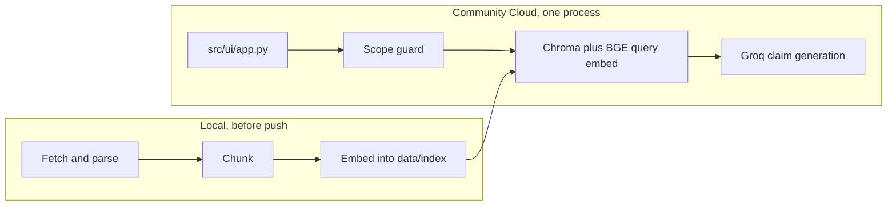

# Deployment plan

Deploy the dietary guidance assistant as one app on [Streamlit Community Cloud](https://share.streamlit.io). The page, the scope guard, retrieval, and Groq claim generation all run in that process. Corpus fetch, parse, chunk, and embed stay local build steps. They do not run on the host.

This follows [implementation-plan.md](./implementation-plan.md) phases 0–8. The running app is the phase 8 page backed by the phase 6 pipeline and the phase 3 Chroma collection.

**Host:** Streamlit Community Cloud, one Python process, entrypoint `src/ui/app.py`.

**Not the host:** a second service for `uvicorn`. Community Cloud starts `streamlit run` and nothing else. The page today calls `POST /chat` over HTTP (`src/ui/client.py`, default `http://127.0.0.1:8000`). That split is how the app runs on a laptop. On Community Cloud the page calls `AnswerPipeline.answer` in-process.

---

## What has to be true

| Fact | Consequence |
| --- | --- |
| One process | The cloud page does not start FastAPI. `view.ask` grows an in-process branch. Local `uvicorn` plus `python scripts/run_ui.py` stays the default. |
| The clone is the filesystem | `data/raw/`, `data/parsed/`, `data/chunks/`, and `data/index/` are gitignored. Answering a question needs only `data/index/` (chunk text and metadata are in the Chroma collection). That directory is 3.6 MB and must be in the repo the host clones. |
| Query embedding is local | `BAAI/bge-small-en-v1.5` still loads in the cloud process. Passages are already embedded. The first question downloads the model weights (about 130 MB) and loads them with PyTorch. |
| Groq stays remote | `GROQ_API_KEY` is a Community Cloud secret. It is never committed. A missing key or a quota failure is the existing `generation_unavailable` response. |
| Memory is the risk that can fail this host | Community Cloud’s published ceiling is about 2.7 GB, and the allocation can sit much lower (forum figures from 2024: roughly 690 MB to 2.7 GB; the numbers can change). Importing PyTorch plus `sentence-transformers` is the large part. Phase D7 is the exit if the app is killed for memory. |

Answering does not read `data/raw/` or `data/chunks/`. Citations come from chunk metadata already stored in the collection (`document_name`, `publisher`, `year`, `source_url`).



---

## Phase D0: Confirm the shape

**Goal:** One Community Cloud app, with the laptop’s two-process run left intact.

### Tasks

1. Keep local start as it is: `uvicorn src.api.main:app`, then `python scripts/run_ui.py`. The launcher sets `CHAT_API_BASE_URL` for the page (the local uvicorn address unless overridden), and that path keeps using `POST /chat`.
2. Make the mode self-selecting in `view.in_process`, so the deploy cannot land on the HTTP path by accident:
   - `CHAT_IN_PROCESS` set: truthy is in-process, anything else is HTTP.
   - Unset, `CHAT_API_BASE_URL` set: HTTP.
   - Neither set: in-process. This is the bare `streamlit run src/ui/app.py` that Community Cloud executes, and nothing listens on `127.0.0.1:8000` there.

   The first deploy did depend on a `CHAT_IN_PROCESS = "1"` secret, and with that secret absent the page posted to `127.0.0.1:8000` and every question showed "Could not reach the chat API". The rule above removes that failure mode; the secret is now optional.
3. Do not shell out to uvicorn from the Streamlit script. A second process is what this host does not keep alive.

### Exit criteria

- Through `python scripts/run_ui.py`, or with `CHAT_API_BASE_URL` set, the page posts to the API.
- With neither variable set, or with `CHAT_IN_PROCESS=1`, a question never calls `client.post_chat`.

---

## Phase D1: Put the index in the clone

**Goal:** `data/index/` is present after a GitHub clone, byte-for-byte the collection that phase 4 measured.

### Tasks

1. Stop ignoring `data/index/` in `.gitignore`. Leave `data/raw/`, `data/parsed/`, and `data/chunks/` ignored. The raw corpus is about 15 MB and is not read at answer time.
2. Commit the whole index directory:
   - `data/index/chroma.sqlite3` (3.4 MB)
   - `data/index/index_manifest.json` (model `BAAI/bge-small-en-v1.5`, 372 chunks, fingerprint `827475e091bad9095b2f721d1de82c400a6d4a9a4119f8f2e7f329c9f47906c1`)
   - the Chroma segment directory next to the sqlite file
3. Prove the collection is relocatable before pushing: copy `data/index/` to a temp directory, open it with `chroma_client` from `src/ingestion/store.py`, and read one row from the `guidance` collection. A path baked into the sqlite file would fail this and must be fixed before the deploy. (Checked on 2026-09-30: the copy opened with 372 rows and `cold-food-storage:0` readable.)
4. Do not rebuild the index on the host. A cloud boot that embeds 372 passages downloads the model and spends the memory budget before the first visitor arrives.

### Deliverables

- [ ] A fresh clone contains `data/index/index_manifest.json` and `chroma.sqlite3`
- [ ] The manifest fingerprint matches the local file above

### Exit criteria

- `GET` equivalent of `src.api.main.health` would report `index_present: true` from the clone, with no fetch and no embed

---

## Phase D2: Dependencies the host installs

**Goal:** Community Cloud installs only what a question needs. `requirements.txt` stays the full local file (parse, test, API).

### Tasks

1. Add the slim list as `src/ui/requirements.txt`, beside the entrypoint. Community Cloud only recognises the standard file names, and it installs the first dependency file it finds, searching the entrypoint's directory before the repo root. So a `requirements.txt` next to `src/ui/app.py` is what the host installs, and the root `requirements.txt` stays the full local file. (A root `requirements-cloud.txt` would be ignored by the host.)

   The slim list is:
   - `streamlit`
   - `chromadb`
   - `sentence-transformers` (this pulls PyTorch; use the CPU wheel index, `--extra-index-url https://download.pytorch.org/whl/cpu`, so the default CUDA build is not installed)
   - `groq`
   - `python-dotenv`
   - `pydantic`
   - `httpx` (already imported by `src/hf_ssl.py` when the embedder configures Hugging Face)

   Leave out `fastapi`, `uvicorn`, `pytest`, `pymupdf`, `pdfplumber`, `beautifulsoup4`. Those build the corpus and serve `POST /chat`. They are not imported on the answer path.
2. Pin the slim file to versions already installed in `.venv` (Python 3.14.6 on this machine). Unpinned `sentence-transformers` can resolve a newer PyTorch than the one that built the index. The index vectors do not change if the model weights are the same `BAAI/bge-small-en-v1.5`; the pin is so the install is repeatable.
3. Keep the answer path free of parse imports. `src/rag/retriever.py` used to import `chroma_client` from `src/ingestion/indexer.py`, which imports the chunker, which imports the parser, which imports `pymupdf` and `bs4`. `chroma_client` now lives in `src/ingestion/store.py` (chromadb and constants only); `indexer.py` re-exports it. A smoke run with those packages blocked from importing is how this is checked.
4. Select **Python 3.12** in the deploy dialog’s Advanced settings. Community Cloud defaults to 3.12 and ignores `runtime.txt`. If the builder still uses 3.14, that matches this repo’s venv; confirm `chromadb` and `sentence-transformers` have wheels for whichever interpreter the log prints, and do not fight it with `runtime.txt`.
5. No `packages.txt`. The answer path does not need an apt package. Chroma’s sqlite and the BGE wheel are pip packages.

### Exit criteria

- A clean venv with only `src/ui/requirements.txt` can import `src.rag.pipeline` and open `data/index/`
- That venv does not import `fitz`, `pdfplumber`, `bs4`, or `fastapi`

---

## Phase D3: In-process page

**Goal:** `streamlit run src/ui/app.py` answers a question with no API process when `CHAT_IN_PROCESS=1`.

### Tasks

1. In `src/ui/view.py`, branch `ask`:
   - `CHAT_IN_PROCESS=1`: call `AnswerPipeline.answer(message, document_id=...)` and store `response.model_dump()`. `ChatResponse` is a pydantic model; `render_response` reads a dict with `type`, `sections`, `searched`, `reason`, and `message`.
   - Otherwise: `client.post_chat`, unchanged.
   - Map pipeline `ValueError` (empty message, unknown `document_id`) to the turn’s `error` string, the same way `ChatError` is shown today.
2. Build the pipeline once per process with `st.cache_resource`. Constructing `AnswerPipeline()` loads BGE on the first retrieve (`src/rag/retriever.py`), not at import. Do not call `answer` at import time, so the disclaimer and the document picker render before the model download.
3. On the first question, use a spinner that says the search model is loading. Later questions keep the existing “Searching the guidance…” spinner. The Hugging Face download goes to the default cache on the container. A rebuild or a cold container fetches it again.
4. Before the first generate, copy `GROQ_API_KEY` and `GROQ_MODEL` from `st.secrets` into `os.environ` when the environment does not already have them. `GroqClaimGenerator` reads the environment (`src/rag/generator.py`). Community Cloud also injects top-level secrets as environment variables; the copy covers a local `secrets.toml` run.
5. No mode secret is required for the cloud app: with `CHAT_API_BASE_URL` unset the page is in-process (phase D0). `CHAT_IN_PROCESS=1` may still be set to force it; `python scripts/run_ui.py` keeps talking to the API because it sets `CHAT_API_BASE_URL`.
6. Add a test that stubs `AnswerPipeline.answer` and asserts `ask` returns that body’s `type` when the variable is set, and that `post_chat` is not called. The existing UI tests should still pass with the variable unset.

`src/ui/app.py` already puts the repo root on `sys.path` and calls `main()` at import. That is a valid Community Cloud entrypoint. No second `streamlit_app.py` is required.

### Deliverables

- [ ] `CHAT_IN_PROCESS=1 streamlit run src/ui/app.py` answers without uvicorn
- [ ] Unset, the page still requires the API

### Exit criteria

- The weight-target chip returns `out_of_scope` and does not load BGE (the guard runs before retrieval)
- A leftovers question returns `type: answer` with at least one section, after the model has loaded
- `pytest tests/test_ui.py` passes

---

## Phase D4: Secrets and local config

**Goal:** The Groq key is on the host and not in git.

### Tasks

1. In the Community Cloud Advanced settings secrets box, paste:

   ```toml
   GROQ_API_KEY = "the key from the local .env"
   GROQ_MODEL = "openai/gpt-oss-20b"
   ```

   `CHAT_IN_PROCESS` is optional (phase D0): leave it out, or set it to `"1"`. Do not set `CHAT_API_BASE_URL` on the host, since that would switch the page back to HTTP.

   Set `GROQ_MODEL`. The code default is `openai/gpt-oss-120b` (`src/constants.py`), and on 2026-09-30 that model returned malformed JSON in Groq's JSON mode for the leftovers and free-sugars questions (a list with keys spilled out as bare strings), so every in-corpus question came back `generation_unavailable` / `invalid_json`. `openai/gpt-oss-20b` returned the expected two-section answer. Re-check the 120b model before removing this override.
2. Add `.streamlit/secrets.toml` to `.gitignore`. A local file with that name is how you try the in-process page before pushing. Do not commit it. `.env` stays ignored.
3. Optional `.streamlit/config.toml` in git, only if you want the page quiet:

   ```toml
   [browser]
   gatherUsageStats = false
   ```

   Community Cloud already runs headless. Do not set a port.

### Exit criteria

- `git status` does not list `.env` or `secrets.toml`
- The deployed process can see `GROQ_API_KEY` (a real question returns `answer` or `not_in_corpus`, not `generation_unavailable` with “GROQ_API_KEY is not set”)

---

## Phase D5: Deploy

**Goal:** A public `*.streamlit.app` URL running `main` on the default branch.

### Tasks

1. Push the branch that contains `data/index/`, `requirements-cloud.txt`, the in-process branch, and the gitignore edits. Community Cloud deploys from GitHub (public or private). The GitHub user needs admin on the repo.
2. In [share.streamlit.io](https://share.streamlit.io): New app → this repo → branch → **Main file path** `src/ui/app.py`.
3. Advanced settings: Python **3.12**, secrets from phase D4. Deploy.
4. Watch the install log. A failure to find a wheel is a Python-version mismatch (phase D2). An app that installs and then dies on the first question with “gone over its resource limits” is phase D7, not a secrets problem.
5. The app sleeps when idle. The first question after wake loads BGE again if the container disk was cleared. That wait is the spinner from phase D3, not a second deploy.

One Groq key serves every visitor. Quota errors surface as `generation_unavailable`. That is the existing generator path; the page already renders it.

### Deliverables

- [ ] The app URL loads the title “Dietary guidance assistant”, the disclaimer, the document picker, and the three example chips
- [ ] The install log shows the slim dependency set, not `pymupdf` or `pytest`

### Exit criteria

- The page is usable in a browser with no local API

---

## Phase D6: Smoke the worked paths

**Goal:** The five architecture §10 paths behave on the deployed URL the way phase 9 describes them locally.

Run these in the deployed page, once with **All documents** and once with the picker on **The Eatwell Guide** for the filtered row. Record `type`, section document ids, and whether each citation URL is one of the seven registry URLs.

| Path | Question | Picker | Expected |
| --- | --- | --- | --- |
| Fridge time | How long can I keep cooked leftovers in the fridge? | All documents | `answer`. At least one section is `cold-food-storage` or `kitchen-companion`. Each claim cites that section’s own URL. |
| Cooking oil | What do the guidelines say about cooking oil? | All documents | `answer`. One section per document that produced a claim. No claim cites a different document. |
| Filtered | According to the Eatwell Guide, how much of the diet should be fruit and vegetables? | The Eatwell Guide | `answer` or `not_in_corpus`. Nothing from another document. |
| Not covered | What is the tariff on imported olive oil? | All documents | `not_in_corpus`. The reply names the documents that were searched. |
| Out of scope | What should I weigh? | All documents | `out_of_scope`, reason `weight_target`. No document list. |

Also send “How many grams of protein are in 100 g of chicken?” and expect `out_of_scope` / `nutrient_lookup`.

The out-of-scope and tariff paths do not need a successful Groq answer. The fridge, oil, and Eatwell paths do.

### Exit criteria

- All five rows match the expected `type`
- A citation link on the page is a registry URL
- Restricting the picker changes the searched set (the Eatwell row does not cite Cold Food Storage)

---

## Phase D7: If the app is killed for memory

**Goal:** A written decision, after one real deploy, about whether this host can hold PyTorch.

Try these in order. Stop when a leftovers question returns `answer`.

1. Confirm a single `st.cache_resource` pipeline. Two `SentenceTransformer` loads will exhaust the allocation.
2. Confirm `requirements-cloud.txt` is what the log installed. A full `requirements.txt` install adds parse libraries the page never uses.
3. Reboot the app once after the model has loaded, and ask again. A first-boot download plus the first encode is the peak.
4. If it still dies with a resource-limit error, Community Cloud cannot host this embedder. Keep the page’s HTTP path and run `uvicorn src.api.main:app` on a host with more than 3 GB RAM, with `CHAT_API_BASE_URL` set to that origin and `CHAT_IN_PROCESS` unset. The index, the Groq secret, and the phase D6 questions are the same. Only the process split changes.

Replacing BGE with an ONNX runtime is a code change to `src/rag/retriever.py`, not a config change. Do that only after step 4 has failed, and only if the ONNX vectors match the stored collection (same model, same query prefix, L2-normalized). A mismatched embedder makes every question `not_in_corpus`.

### Exit criteria

- Either the Community Cloud URL passes phase D6, or the page is pointed at an API whose `/health` reports the index present and phase D6 passes there

---

## Checklist

| Step | Where |
| --- | --- |
| Index committed, raw corpus not committed | Phase D1 |
| Slim install file, Python chosen in the dialog | Phase D2 |
| `CHAT_IN_PROCESS=1` calls the pipeline | Phase D3 |
| `GROQ_API_KEY` in Cloud secrets only | Phase D4 |
| App URL serves `src/ui/app.py` | Phase D5 |
| Five worked paths plus the nutrient-lookup refusal | Phase D6 |
| Memory fallback recorded if the process is killed | Phase D7 |
