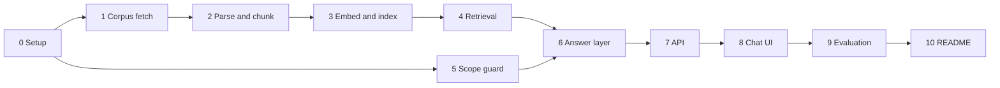

# Phase-Wise Implementation Plan

This plan builds the dietary guidance RAG chatbot described in [problemStatement.md](./problemStatement.md) and [architecture.md](./architecture.md). Each phase has a goal, tasks, deliverables, and exit criteria. A later phase starts only after the previous phase's exit criteria pass.

**Stack:** Python 3.11+ · Groq for claim generation · BGE (`BAAI/bge-small-en-v1.5`) for local embeddings · Chroma for the vector index · FastAPI for `POST /chat` · Streamlit for the chat page.

---

## Overview

| Phase | Name | Primary output | Problem requirement |
| --- | --- | --- | --- |
| 0 | Project setup | Repo, registry, dependencies | — |
| 1 | Corpus fetch | Seven raw files plus provenance manifest | §3.1 Corpus |
| 2 | Parse and chunk | Structure-aware chunks sized from the parsed blocks | §3.2 Chunking |
| 3 | Embed and index | Chroma collection | §3.3 Retrieval (store) |
| 4 | Retrieval | Cross-corpus and single-document search | §3.3 Retrieval |
| 5 | Scope guard | Code refusals for out-of-scope questions | §3.6b Out of scope |
| 6 | Answer layer | Cited, per-document claims and not-in-corpus refusal | §3.4, §3.5, §3.6a |
| 7 | Chat API | `POST /chat` | Architecture §8 |
| 8 | Chat UI | Document picker, per-document answers, two refusal styles | Architecture §8 |
| 9 | Evaluation | The five worked paths in architecture §10 | All of §3 |
| 10 | README | How to run it, and the chunking trade-off | §3.2 README note |

Phases 4 and 5 can be built in either order once phase 0 is done. Phase 5 does not need the index. Phase 6 needs both.

---

## Phase 0: Project setup

**Goal:** A runnable project skeleton whose corpus registry matches architecture §2, so later phases import one allowlist for fetch, filter, and citation.

### Tasks

1. Create the layout from architecture §9:
   - `src/ingestion/`, `src/rag/`, `src/api/`, `src/ui/`
   - `scripts/`, `tests/`, `data/raw/`, `data/chunks/`, `data/index/`
2. Add `requirements.txt`:
   - `fastapi`, `uvicorn`, `pydantic`, `python-dotenv`
   - `httpx`, `beautifulsoup4`
   - `pymupdf`, `pdfplumber` (text layer and tables)
   - `chromadb`, `sentence-transformers`
   - `groq`
   - `streamlit`
   - `pytest`
3. Add `src/constants.py` with the seven registry rows from architecture §2: `document_id`, document name, publisher, year, source URL, kind (`pdf` or `html`), and aliases.
4. Add thresholds in the same module: `MAX_CHUNK_TOKENS = 800`, packing target `400`, `CHUNK_OVERLAP_TOKENS = 50`, `TOP_K_ALL = 8`, `TOP_K_FILTERED = 5`, `MAX_CHUNKS_PER_DOCUMENT = 3`, `MIN_SIMILARITY = 0.45` (a placeholder; phase 4 sets it to 0.62 from the built index and adds `CANDIDATE_K = 24`), `BGE_MODEL_NAME = BAAI/bge-small-en-v1.5`, `BGE_QUERY_PREFIX`.
5. Add `.env.example` with `GROQ_API_KEY` and `GROQ_MODEL`. Add `.gitignore` for `.env`, `data/raw/`, `data/chunks/`, `data/index/`, and `__pycache__/`.
6. Add empty package `__init__.py` files and a `scripts/build_index.py` stub that calls the ingestion pipeline.

### Deliverables

- [ ] Virtualenv installs from `requirements.txt`
- [ ] Registry lists exactly the seven `document_id`s in architecture §2
- [ ] `scripts/build_index.py` exists and exits with a clear "not implemented" error until phase 3

### Exit criteria

- `python -c "from src.constants import CORPUS; assert len(CORPUS) == 7"` succeeds
- No source URL outside the problem-statement table is present in the registry

---

## Phase 1: Corpus fetch

**Goal:** Download the seven documents and store publisher, year, source URL, and retrieval date with each file (problem statement §3.1).

### Tasks

1. Implement `src/ingestion/fetcher.py`.
   - Request each registry URL with a browser User-Agent. Several hosts return 403 without one.
   - Follow redirects and record the final URL.
   - Write bytes to `data/raw/<document_id>/source.pdf` or `source.html`.
   - For `fao-who-healthy-diets` and `who-five-keys`, the registry URL is a publication page. If the saved HTML is a landing page, follow the English PDF (or English full-text) link on that page and store that file as the source. Record both the registry URL (the citation link) and the downloaded asset URL in the manifest.
2. Write `data/corpus_manifest.json` with one row per document: `document_id`, `publisher`, `year`, `source_url`, `downloaded_url`, `retrieval_date` (UTC date), `sha256`, `http_status`, `status` (`ok` or `stale`).
3. On a later run, skip a document whose hash is unchanged. On a failed download, keep the previous file and set `status` to `stale`.
4. Add `tests/test_fetcher.py` using saved HTML/PDF fixtures and a mocked HTTP client. Do not hit the network in unit tests.

### Deliverables

- [ ] `data/raw/` contains seven source files after a real fetch
- [ ] `data/corpus_manifest.json` has publisher, year, source URL, and retrieval date for each
- [ ] Fetcher unit tests pass offline

### Exit criteria

- A fresh run against the network leaves seven `status: ok` rows, or it stops with a named `document_id` rather than indexing a partial corpus
- Re-running with unchanged files does not rewrite those files
- A simulated failed download leaves the previous bytes in place and marks that row `stale`

---

## Phase 2: Parse and chunk

**Goal:** Turn `data/parsed/blocks.jsonl` into structure-aware chunks. Boundaries follow block type and the sizes actually in that file. Every chunk carries document name, publisher, year, and section heading (problem statement §3.2).

The parsed corpus is 1,001 blocks across the seven documents: 176 headings, 383 paragraphs, 430 list items, and 12 tables. Headings are context, not chunks. Every content block already has a non-empty `heading_path` (depth 1–4).

Observed sizes (tokens ≈ words × 1.3):

| Block | Count | Median words | Max words | What that means for a chunk |
| --- | --- | --- | --- | --- |
| Paragraph | 383 | 27 | 179 (~230 tokens) | No paragraph reaches the 800-token cap. 213 are under ~40 tokens, so a paragraph alone is often too thin to embed. |
| List item | 430 | 19 | 146 (~190 tokens) | 395 items have no number. 181 are under ~20 tokens, and many are fragments (`Faeces;`, `always including vegetables in meals;`). They sit in 108 runs (median 3 items, 70 words). 70 runs have a short lead-in paragraph (median 15 words). |
| Table | 12 | 274 (whole grid) | 1,058 (~1,400 tokens) | The only blocks over the cap. Five grids exceed ~400 tokens. Labeled rows are 9–215 words, so a row is a safe unit and a whole large grid is not. |

### Tasks

1. Implement `src/ingestion/parser.py`.
   - PDF: extract headings, paragraphs, and list items from the text layer; extract tables with a table extractor. Drop reading-order text that only repeats a table already extracted.
   - HTML: map `h1`–`h3` to headings, paragraphs to `paragraph`, `ol`/`ul` items to `list_item`, and `<table>` to `table`. Strip nav, cookie banners, and feedback widgets.
   - Emit blocks with `type`, `text`, and `heading_path`. Tables also carry `header`, `rows`, and `caption` when the parser found one.
   - Cold Food Storage Chart: one table, 53 data rows, no empty cells. The `Food` category is already filled on every row.
2. Implement `src/ingestion/chunker.py`. Read `data/parsed/blocks.jsonl`. Estimate tokens as `round(word_count × 1.3)` so chunking does not load BGE. Pack toward `CHUNK_TARGET_TOKENS` (400). The 800-token cap is a guard for a single unit this corpus does not contain.
   - **Headings.** Skip them. `section_heading` is `heading_path` joined with ` > `. Fourteen headings have no body (section titles only); their text is already on the child path.
   - **Paragraphs.** Pack consecutive paragraphs under the same heading up to 400 tokens, breaking only between paragraphs. The longest single paragraph is 179 words, so this corpus does not sentence-split prose. Seven prose runs exceed ~300 words and become two or more chunks. The largest is the FAO “Table 1” path (21 paragraphs, 623 words): the short macronutrient lines pack together, and the protein, fat, and carbohydrate essays fall into later chunks. Glossary entries (`heading_path` ending in `Glossary`, 25 definitions in Five Keys, 514 words) stay one chunk each. Each paragraph is already a term plus its definition.
   - **Lists.** Pack a consecutive run of `list_item`s under the same heading up to 400 tokens. Keep every item whole, including its number. Two runs exceed the target (`Healthy diet > HOW TO PROMOTE HEALTHY DIETS`, 20 items, 341 words; `Power Outages`, 11 items, 326 words): continue the next chunk at the next item, with no overlap. When the block immediately before the run is a paragraph on the same heading of at most 80 words, put that lead-in at the start of the first list chunk and leave it out of the paragraph chunks. Thirty-five items open with a number. The FAO annex runs (19 items, 83–161 words per run), Eatwell’s eight tips (64 words), and the Kitchen Companion thermometer and microwave steps each stay inside one list chunk for that run.
   - **Tables.** Keep the grid as one chunk when its word count × 1.3 is at most 400. That covers seven tables: Eatwell sugar by age (58 words), Eatwell energy requirements (169), the safe-minimum-internal-temperature chart (104), turkey thawing (102), turkey roasting times (173), alternate turkey methods (233), and the egg storage chart (274). Split the other five into one chunk per data row, because the grid itself is over the target: Cold Food Storage (53 rows, 1,058 words), Eatwell “8 tips” (6 rows of 110–205 words), the Kitchen Companion cold-storage chart (17 rows), and the two roast charts (8 and 11 rows). A split row’s `text` is the caption (if any) plus labeled cells, header names included, for example `Food: Fresh poultry | Type: Chicken or turkey, whole | Refrigerator [40°F (4°C) or below]: 1 to 2 days | Freezer [0°F (-18°C) or below]: 1 year`. Omit a cell that is empty (two cells in the chicken roast chart). Keep each row whole: the longest row is the Eatwell fruit-and-vegetables tip at 215 words, still under the cap. Index either the whole grid or its rows, not both. The Kitchen Companion cold-storage chart overlaps Cold Food Storage; keep both, so each publisher can be cited. Leave the Cold Food Storage intro paragraph (freezer times are for quality only) as its own paragraph chunk.
   - **Safety valve.** If a single paragraph ever exceeds 800 tokens, split it on sentence boundaries with about 50 tokens of overlap (`CHUNK_OVERLAP_TOKENS`). Both pieces keep the same `section_heading`. Do not apply that overlap to list items or table rows.
   - Set `chunk_id` to `{document_id}:{ordinal}` over chunks, not blocks. Fields: `document_name`, `publisher`, `year`, `source_url`, `retrieval_date`, `section_heading`, `block_type` (`paragraph`, `list`, `table`, or `table_row`), `text`, and `embed_text` (`"{document_name} — {section_heading}\n{text}"`). The prefix matters most on storage rows of about 23–43 words.
3. Write chunks to `data/chunks/chunks.jsonl`. On this corpus the rules above produce 372 chunks from 825 content blocks: 159 paragraph chunks (26 of them glossary entries, including the short glossary intro), 111 list chunks, 7 whole-table chunks, and 95 table-row chunks. The earlier estimate of about 450 counted lead-in paragraphs again as their own chunks. Kitchen Companion is 169 of the 372. Cold Food Storage is the intro paragraph plus 53 rows.
4. Add tests against parsed fixtures, not only synthetic ones:
   - Every chunk has document name, publisher, year, and a non-empty section heading.
   - A Cold Food Storage leftovers row contains that row’s refrigerator and freezer values, and does not contain the whole-chicken row.
   - The Eatwell sugar table (3 age rows, 58 words) is one chunk containing all three ages.
   - The Eatwell “8 tips” fruit-and-vegetables row is its own chunk, includes the 5-a-day guidance, and does not include the oils-and-spreads row.
   - Eatwell tips 1–8 share one list chunk, and each number is present.
   - A Five Keys fragment such as `Faeces;` is in the same chunk as the sibling items under that heading.
   - The Five Keys glossary entry for “Danger zone” is its own chunk and does not contain “Cross-contamination”.
   - A synthetic paragraph over 800 tokens is split on a sentence boundary, and both chunks share `section_heading`.

### Deliverables

- [ ] `data/chunks/chunks.jsonl` produced from `data/parsed/blocks.jsonl`
- [ ] Parser and chunker tests pass
- [ ] A short note in the phase PR description (folded into the README in phase 10) stating the choice and its cost: a size branch for tables, packed list runs, one chunk per glossary entry, uneven sizes, and heading context carried in metadata and `embed_text`

### Exit criteria

- Chunk JSONL covers all seven `document_id`s
- Cold Food Storage contributes one row chunk per data row; each row that had both a refrigerator value and a freezer value still has both
- A table at or under the 400-token target remains one chunk
- `embed_text` starts with the document name
- No heading block is emitted as a chunk

---

## Phase 3: Embed and index

**Goal:** A local Chroma collection over the 372 chunks in `data/chunks/chunks.jsonl`, embedded with a model whose window covers every `embed_text` in that file (architecture §4.4).

Token counts below are `BAAI/bge-small-en-v1.5` WordPiece tokens on `embed_text`, including `[CLS]` and `[SEP]`. That model's limit is 512. The chunker's word × 1.3 estimate tracks the median (1.33 tokens per word) and runs low on the long tail (up to 2.0 tokens per word), so the model window is sized from the tokenizer, not from the estimate. `who-healthy-diet:2` is about 400 tokens by the estimate and 479 by the tokenizer.

| | Count | Min | Median | p90 | Max | Over 256 | Over 512 |
| --- | --- | --- | --- | --- | --- | --- | --- |
| All chunks | 372 | 15 | 83 | 270 | 479 | 43 | 0 |
| paragraph | 159 | 15 | 73 | 281 | 454 | 18 | 0 |
| list | 111 | 34 | 135 | 318 | 479 | 20 | 0 |
| table_row | 95 | 56 | 73 | 110 | 282 | 2 | 0 |
| table | 7 | 95 | 243 | 322 | 388 | 3 | 0 |

Twelve chunks are between 384 and 511 tokens. The longest is `who-healthy-diet:2` (the adult healthy-diet list, 479 tokens, 33 tokens of room). Next is `fao-who-healthy-diets:7` at 454. Ninety-eight chunks are under 64 tokens. On 14 chunks the document-and-heading prefix is more than half the tokens; the shortest glossary line, `who-five-keys:57` ("Toxic Harmful or poisonous"), is 15 tokens, 9 of them prefix. Cold Food Storage is 54 chunks under one heading, 56–88 tokens, with the same column labels on every row. Kitchen Companion is 169 of the 372.

**Model:** `BAAI/bge-small-en-v1.5`. 384 dimensions, 512-token window, local, English. Passages are `embed_text` with no query prefix. Phase 4 prefixes queries with `BGE_QUERY_PREFIX` (`Represent this sentence for searching relevant passages: `, 8 tokens). L2-normalize. Cosine in Chroma.

The file is what settles the model:

- The 512-token window covers the file. The longest chunk still has 33 tokens of room. Truncating that chunk would drop the tail of the adult-diet list, and the heading prefix sits at the front, so the lost tokens are the guidance.
- A 256-token model drops 43 chunks. `all-MiniLM-L6-v2` would cut the WHO adult list, the FAO principle paragraphs, and the longer Kitchen Companion procedure lists. It is a symmetric similarity model and has no query instruction. The questions here are short ("how long can cooked leftovers stay in the fridge") against labeled rows of about 70 tokens, which is the asymmetric case that prefix is for.
- An 8,192-token multilingual model does not match a file whose longest passage is 479 tokens of English. `bge-m3` adds that window and that vocabulary for no chunk in this file.
- A larger BGE keeps the same window. `bge-base-en-v1.5` (768) and `bge-large-en-v1.5` (1,024) share the 512-token limit and the same query prefix. 372 vectors do not need the extra dimensions to store. Keep small. Phase 9 is the point to reconsider base, and only if a threshold change cannot separate the Cold Food Storage rows, which share a heading and differ by food name and the two storage times.

### Tasks

1. Implement `src/ingestion/indexer.py`.
   - Load `BAAI/bge-small-en-v1.5`.
   - Embed `embed_text` only. Leave `BGE_QUERY_PREFIX` off passages.
   - Count tokens with this tokenizer, special tokens included. Stop the build before any upsert when a chunk is over 512. On this file the maximum is 479 (`who-healthy-diet:2`). Keep the chunker output as it is; the model still has room.
   - L2-normalize. One persistent collection at `data/index/`, cosine space. On these vectors Chroma's cosine distance is `1 - similarity`. Phase 4 compares similarity.
   - Id is `chunk_id`. Document body is `text`, the string phase 6 cites. Metadata is the scalars already on each JSONL row: `document_id`, `document_name`, `publisher`, `year` (int), `source_url`, `section_heading`, `block_type` (`paragraph`, `list`, `table`, or `table_row`), `retrieval_date`. Leave `embed_text` out of metadata.
   - Upsert all 372 rows. A later run with the same ids replaces those rows.
2. Write `data/index/index_manifest.json` with model name, dimension (384), max sequence length (512), the observed maximum token count, chunk count, a sha256 fingerprint of `chunk_id + embed_text` in file order, and `embedded_at`. Skip re-embedding when the fingerprint and the model name both match.
3. Implement `src/ingestion/pipeline.py`: fetch, then parse, then chunk, then index. Refuse to index when any corpus-manifest row is `stale`.
4. Wire `scripts/build_index.py` to that pipeline.
5. Add `tests/test_indexer.py` with a tiny fixture collection (fake or a temp Chroma directory):
   - Metadata fields round-trip, including `year` as an int and `block_type`.
   - A fixture passage over 512 tokens is rejected, and nothing is upserted.
   - The embedder receives `embed_text`, and that string does not start with `BGE_QUERY_PREFIX`.

### Deliverables

- [ ] `python -m scripts.build_index` builds `data/index/` from the 372 chunks
- [ ] Index manifest records model `BAAI/bge-small-en-v1.5`, dimension 384, observed max tokens, count 372, fingerprint, and timestamp
- [ ] A second run with the same chunks does not re-embed

### Exit criteria

- Collection count equals 372, the line count of `chunks.jsonl`
- Manifest max token count matches a fresh tokenization of `embed_text` and is at most 512
- The stored record for `cold-food-storage:24` returns the whole-chicken refrigerator and freezer text (`1 to 2 days`, `1 year`) and the registry `source_url`
- `document_id` metadata is one of the seven registry ids
- `block_type` on a stored row is one of `paragraph`, `list`, `table`, `table_row`

---

## Phase 4: Retrieval

**Goal:** Vector search across all documents, and vector search filtered to one named document (problem statement §3.3). The threshold, the candidate count, and the per-document cap are set from the similarities the phase 3 index returns, not from defaults.

Similarities below are cosine on the stored vectors (`1 - distance`), with the query prefixed by `BGE_QUERY_PREFIX`, measured against the 372-chunk collection in `data/index/`. "n ≥ t" is the number of chunks in the searched scope at or above similarity `t`.

| Question | Scope | Top hit | Top sim | n ≥ 0.45 | n ≥ 0.62 |
| --- | --- | --- | --- | --- | --- |
| How long can I keep cooked leftovers in the fridge? | all (372) | `kitchen-companion:140` | 0.847 | 364 | 189 |
| How long can I keep eggs in the fridge? | all | `kitchen-companion:113` | 0.889 | 361 | 148 |
| How much salt per day? | all | `who-healthy-diet:9` | 0.834 | 332 | 21 |
| What is the danger zone temperature? | all | `who-five-keys:39` | 0.816 | 272 | 12 |
| What do the guidelines say about cooking oil? | all | `eatwell-guide:34` | 0.726 | 370 | 80 |
| What does WHO say about limiting free sugars? | all | `who-healthy-diet:12` | 0.669 | 152 | 5 |
| According to the Eatwell Guide, how much … fruit and vegetables? | `eatwell-guide` (39) | `eatwell-guide:2` | 0.832 | 39 | 33 |
| What is the tariff on imported olive oil? | all | `eatwell-guide:34` | 0.575 | 147 | 0 |
| How do I refinance my mortgage? | all | `kitchen-companion:49` | 0.594 | 255 | 0 |
| How do I write a for loop in Python? | all | `eatwell-guide:24` | 0.572 | 359 | 0 |
| What is the weather in Paris tomorrow? | all | `who-five-keys:39` | 0.517 | 52 | 0 |
| How long can I keep raw chicken in the fridge? | `eatwell-guide` | `eatwell-guide:33` | 0.604 | 39 | 0 |
| How do I thaw a frozen turkey? | `who-healthy-diet` (19) | `who-healthy-diet:8` | 0.479 | 3 | 0 |
| What is the tariff on imported olive oil? | `fsa-chill` (11) | `fsa-chill:6` | 0.442 | 0 | 0 |

Across fourteen in-corpus questions the top hit scored 0.669 (free sugars) to 0.899 (hand washing). Across ten off-topic questions the top hit scored 0.407 (US history) to 0.594 (mortgage); the four filtered misses above peaked at 0.442–0.604. The two ranges do not overlap: the gap is 0.604–0.669. Every chunk in the collection scores at least 0.32 against any of these queries, and the median chunk scores 0.41–0.62 depending on the question.

The index settles the retrieval settings:

- **`MIN_SIMILARITY` moves from 0.45 to 0.62.** At 0.45 the threshold never removes a top-8 hit and never empties a result: the tariff question keeps 147 chunks, the Python question 359. The not-in-corpus path would then run on Groq's output and the validator, not on retrieval. At 0.62 all four off-topic questions and all three filtered misses return zero chunks, and the weakest in-corpus question (free sugars) keeps five, all about sugar. The margin is 0.016 below (the Eatwell chicken miss at 0.604) and 0.049 above (free sugars at 0.669). Phase 9 tunes inside 0.60–0.66; a value outside that band fails one of these probes.
- **The threshold is calibrated for prefixed queries.** Without `BGE_QUERY_PREFIX` the same questions score about 0.03–0.04 higher against every chunk (tariff 0.575 → 0.600, free sugars 0.669 → 0.705), and the top hit does not change. The prefix and the threshold change together or not at all.
- **Fetch 24 candidates, not 8.** Kitchen Companion is 169 of 372 chunks. On the leftovers, cooking-oil, thawing, and danger-zone questions it fills 6–8 of the raw top 8. For cooking oil the raw top 8 is one Eatwell row and seven Kitchen Companion roasting chunks; the WHO fat-intake list (`who-healthy-diet:8`, 0.694) sits at rank 10 and is lost. Fetching `CANDIDATE_K = 24` (three per document cap times eight kept), thresholding, then capping at 3 per document turns that result into Eatwell 2, Kitchen Companion 3, WHO 1. On the leftovers question it turns 6/1/1 into Kitchen Companion 3, Cold Food Storage 3, FSA 2. Chroma returns 24 of 372 in the same call as 8.
- **Cap of 3 per document, then keep the best 8.** The cap is what lets a second and third publisher into the prompt. The final cut of 8 is by similarity after the cap. Fewer than 8 is normal: the danger-zone question keeps 5 at 0.62 and the free-sugars question keeps 5.
- **Row chunks rank correctly, with thin margins.** On "How long can raw whole chicken stay in the freezer?", `cold-food-storage:24` (whole) scores 0.793 and `:25` (pieces) 0.774. On eggs, raw-in-shell scores 0.828 and the eggnog rows 0.820. On leftovers filtered to Cold Food Storage the three leftover rows (meat, nuggets, pizza) are the top three at 0.815, 0.782, 0.772, and the fourth hit is a ham row at 0.752. The right row is first in each probe, so `bge-small` stays; sibling rows differ by 0.01–0.03 and will often ride along inside the cap of 3. The generator's chunk text carries the food name, so Groq sees the distinction the vector barely does.
- **The two overlapping storage charts both surface.** Leftovers returns `kitchen-companion:37` (0.839) and `cold-food-storage:51` (0.815), so phase 6 renders two sections with two publishers, as phase 2 intended when it kept both charts.
- **Retrieval is not the scope guard.** "What should I weigh?" scores 0.743 against `eatwell-guide:26` and would pass any threshold in the band. "How many calories are in a banana?" scores 0.625. The phase 5 guard must run first; the retriever assumes the message is in scope.
- **In-domain neighbours pass the threshold.** "How much salt per day?" keeps `fao-who-healthy-diets:19` (non-sugar sweeteners, 0.692) and "danger zone" keeps `kitchen-companion:144` (keep cold food cold, 0.684). No threshold in the band removes them without removing real hits. Those are the phase 6 validator's job: a claim must be supported by its cited chunk, so an unused chunk costs prompt tokens and nothing else.
- **Filtered scope.** The smallest documents are `fsa-chill` (11 chunks), `who-healthy-diet` (19), and `fao-who-healthy-diets` (20). Under a `where` filter Chroma returns at most the document's chunk count, so `n_results` is `min(TOP_K_FILTERED, count)` in effect. Within one document the cap of 3 does not apply; all survivors up to `TOP_K_FILTERED = 5` are kept, because one document is one section and the cap exists to share slots between documents. On `fsa-chill` every chunk shares one heading and the defrost question scores 0.795–0.882 across all eleven, so the filtered result there is the top 5 by similarity.

### Tasks

1. Update `src/constants.py`: `MIN_SIMILARITY = 0.62`, add `CANDIDATE_K = 24`. Leave `TOP_K_ALL = 8`, `TOP_K_FILTERED = 5`, and `MAX_CHUNKS_PER_DOCUMENT = 3`. Record the 0.60–0.66 band in a comment next to the threshold with the two probes that bound it.
2. Implement `src/rag/retriever.py`.
   - Load `BAAI/bge-small-en-v1.5` once, `max_seq_length = 512`, and embed `BGE_QUERY_PREFIX + message` with `normalize_embeddings=True`. Open the collection with `embedding_function=None`, the same way `indexer.py` does, so Chroma never embeds the query itself.
   - Similarity is `1 - distance` from Chroma's cosine space. Compare and report similarity, not distance.
   - Unfiltered: `n_results = CANDIDATE_K`. Filtered: `n_results = TOP_K_FILTERED`, with `where={"document_id": document_id}`. Reject a `document_id` outside `DOCUMENT_IDS` before querying.
   - Drop hits below `MIN_SIMILARITY`.
   - Unfiltered: walk survivors in similarity order, skip a hit once its document already has `MAX_CHUNKS_PER_DOCUMENT`, stop at `TOP_K_ALL`. Filtered: keep all survivors.
   - Group the kept hits by `document_id` in registry order. Each hit carries `chunk_id`, `text`, similarity, and the eight metadata fields from phase 3.
3. Return a result object with the searched scope (the one `document_id`, or all seven in registry order), the grouped hits, and the raw candidate count before the threshold, for the phase 9 log. An empty group list is a valid result; the retriever does not call Groq and does not build refusal text (phase 6 does).
4. Add `scripts/probe_retrieval.py`: takes a question and an optional `document_id`, prints the top 10 candidates with similarity, `chunk_id`, `block_type`, heading, and the first 80 characters of text, then the grouped result. Phase 9 uses it to record threshold decisions.
5. Tests against a temp index built with the phase 3 test fixtures, plus the real index when `data/index/` exists (skip otherwise):
   - A query filtered to `eatwell-guide` returns only that `document_id`, and a `document_id` outside the registry raises before Chroma is called.
   - A query with no filter can return more than one `document_id`, and no document exceeds 3 hits.
   - A fixture hit at similarity 0.61 is absent from the grouped result; one at 0.63 is present.
   - The embedded query string starts with `BGE_QUERY_PREFIX`; the fake embedder asserts it.
   - Real index, if present: "How long can I keep cooked leftovers in the fridge?" groups include both `cold-food-storage` and `kitchen-companion`; "What is the tariff on imported olive oil?" returns an empty group list with all seven documents in `searched`; "How do I thaw a frozen turkey?" filtered to `who-healthy-diet` returns an empty group list with that one document in `searched`.

### Deliverables

- [ ] `Retriever.retrieve(query, document_id=None)` implements both modes
- [ ] `src/constants.py` carries `MIN_SIMILARITY = 0.62` and `CANDIDATE_K = 24`
- [ ] `scripts/probe_retrieval.py` prints candidates and the grouped result for one question
- [ ] Retrieval tests pass offline; the real-index tests pass when the index is built

### Exit criteria

- Filtered search cannot return a chunk whose `document_id` differs from the filter
- Unfiltered search reads the single collection that holds all seven documents, fetches 24 candidates, and returns at most 8 hits with at most 3 per document
- On the real index, the four off-topic probes above return no hits and the seven in-corpus probes each return at least one
- Empty results are returned as an empty group list plus the searched scope, not as an exception

---

## Phase 5: Scope guard and refusal templates

**Goal:** Enforce out-of-scope questions in code, before retrieval and before Groq (problem statement §3.6b, architecture §5.1 and §7.2). This phase can proceed in parallel with phase 4.

### Tasks

1. Implement `src/rag/classifier.py`.
   - `medical`: diagnosis, symptoms, medicines, "I have [condition]", treatment, whether a food is safe for a stated illness.
   - `calorie_target`: how many calories the person should eat, a deficit, a personal calorie goal.
   - `weight_target`: what the person should weigh, ideal weight, a personal weight goal.
   - `nutrient_lookup`: calories, protein, or another nutrient amount in a named food ("protein in 100 g of chicken").
   - Population-guidance wording stays in scope: "what does the guidance say about free sugars", "salt under 5 g per day".
   - Detect a single named document from registry aliases. If two documents are named, leave the scope unfiltered so both can be retrieved. An explicit `document_id` argument overrides aliases.
2. Implement `src/rag/refusal.py` with fixed strings, no model call.
   - `out_of_scope` for `medical`, `calorie_target`, and `weight_target`: decline and point to a qualified professional. `searched` is empty.
   - `out_of_scope` / `nutrient_lookup`: say this assistant answers from dietary guidance documents and does not look up nutrient numbers for individual foods.
   - `not_in_corpus`: say the guidance searched does not cover the question, and list each searched document's name, publisher, and year. Used by phase 6; write the template here.
   - `generation_unavailable`: used when Groq errors or the quota is exceeded. This template does not say the guidance was searched and found empty.
3. Add `tests/test_classifier.py` and `tests/test_refusal.py`.

### Deliverables

- [ ] Classifier returns a reason code without importing the retriever or the Groq client
- [ ] Refusal builders return the response shapes in architecture §8

### Exit criteria

- "What should I weigh?" returns `out_of_scope` / `weight_target` and the professional referral
- "How many calories should I eat a day?" returns `calorie_target`
- "I have diabetes, what should I eat?" returns `medical`
- "Protein in 100 g of chicken" returns `nutrient_lookup`
- "What does WHO say about limiting free sugars?" is in scope, and the alias detector sets `who-healthy-diet` when the wording names that document
- "According to the Eatwell Guide" sets `eatwell-guide`

---

## Phase 6: Answer layer

**Goal:** Answers come only from retrieved chunks. Every claim carries document name, publisher, year, and link. Two documents produce two sections. A miss names what was searched (problem statement §3.4, §3.5, §3.6a).

### Tasks

1. Add response models (`src/rag/models.py`) matching architecture §8: `type` of `answer`, `not_in_corpus`, `out_of_scope`, or `generation_unavailable`; `sections`; `searched`; `reason`.
2. Implement `src/rag/generator.py`.
   - Build a prompt that contains only the grouped chunk text and chunk ids.
   - Ask Groq for the JSON shape in architecture §5.4: per `document_id`, a list of claims each with `text` and `chunk_ids`.
   - Parse JSON strictly. Invalid JSON is a generation failure, which becomes `generation_unavailable`.
3. Implement `src/rag/citations.py`.
   - For each surviving claim, attach name, publisher, year, and `source_url` from the chunk record.
   - Order sections by registry order.
4. Implement `src/rag/validator.py`. Drop a claim when:
   - its `chunk_id` is not in that document's retrieved set
   - its text is empty, or its distinctive numbers and food terms are absent from the cited chunk
   - the citation URL is not that document's allowlisted `source_url`
   - the claim text matches the medical, calorie-target, or weight-target patterns
   - If no claim survives, the pipeline emits `not_in_corpus` for the searched scope.
5. Implement `src/rag/pipeline.py` in this order:
   1. Normalize the message. Reject an empty message.
   2. Run the scope guard. On a match, return the out-of-scope template and do not retrieve.
   3. Resolve `document_id` from the request, else from aliases.
   4. Retrieve. On no surviving hits, return `not_in_corpus` and do not call Groq.
   5. Generate, render citations, validate.
   6. On Groq quota or transport errors, return `generation_unavailable`.
6. Tests with a fake retriever and a fake Groq client:
   - Two supporting documents yield two sections. No claim cites chunk ids from two documents.
   - A claim whose `chunk_id` was not retrieved is dropped.
   - All claims dropped yields `not_in_corpus` naming the searched documents.
   - An in-scope miss does not call the fake Groq client.
   - A weight-target question does not call the fake retriever.
   - Rendered citation URL equals the chunk's `source_url`.

### Deliverables

- [ ] `answer(message, document_id=None)` returns the architecture response
- [ ] Pipeline tests pass without a network call

### Exit criteria

- A fabricated multi-document Groq payload is rendered as one section per document, citations filled from metadata
- The string "the guidelines say" is not added by the renderer
- Filtered scope on a miss lists only that document's name, publisher, and year
- Out-of-scope responses have an empty `searched` list

---

## Phase 7: Chat API

**Goal:** One HTTP entry point for the pipeline (architecture §8).

### Tasks

1. Implement `src/api/main.py` with FastAPI.
   - `POST /chat` body: `message` (required string), `document_id` (optional).
   - Reject a `document_id` that is not in the registry with HTTP 422.
   - Reject an empty `message` with HTTP 422.
   - Return the pipeline JSON unchanged, including `type`, `sections`, `searched`, and `reason`.
   - `GET /health` returns ok when the Chroma directory exists.
2. Add `tests/test_api.py` using FastAPI's test client and a pipeline stub.

### Deliverables

- [ ] `uvicorn src.api.main:app` serves `/chat` and `/health`
- [ ] API tests pass

### Exit criteria

- A stubbed in-scope answer, a `not_in_corpus` answer, and an `out_of_scope` answer each round-trip with their `type` intact
- An unknown `document_id` is 422 and does not call the pipeline

---

## Phase 8: Chat UI

**Goal:** A single page that shows per-document answers and makes the two refusals visually distinct (architecture §8).

### Tasks

1. Implement `src/ui/app.py` (Streamlit) and `scripts/run_ui.py`.
2. Show a disclaimer: answers come from the seven official guidance documents; this is not medical advice.
3. Add a document picker whose options are "All documents" plus the seven registry names. "All documents" sends `document_id: null`.
4. Add example chips:
   - a fridge-time question ("How long can I keep cooked leftovers in the fridge?")
   - an Eatwell oil question ("According to the Eatwell Guide, where do oils and spreads fit?")
   - a weight-target question ("What should I weigh?")
5. Render `type: answer` as one block per section, citation under each claim: document name, publisher, year, and link.
6. Render `not_in_corpus` with the message and the searched list.
7. Render `out_of_scope` with the decline and the professional referral, and without a searched list.
8. Point the UI at `POST /chat` via a base URL setting.

### Deliverables

- [ ] Chat page runs locally against the API
- [ ] The three example chips send the messages above

### Exit criteria

- An answer with two sections shows two citation blocks
- The weight-target chip shows the out-of-scope state and no document list
- The picker restricted to one document sends that `document_id`

---

## Phase 9: Evaluation

**Goal:** Run the five worked paths in architecture §10 against the real index and a real Groq call, and record the results.

### Tasks

1. Add `scripts/eval_paths.py` (or a checked-in `docs/eval.md` filled by a script) for these questions:

| Path | Question | Expected `type` | Expected shape |
| --- | --- | --- | --- |
| Fridge time | How long can I keep cooked leftovers in the fridge? | `answer` | At least one section whose `document_id` is `cold-food-storage` or `kitchen-companion`. Each claim cites that section's own URL. |
| Cooking oil | What do the guidelines say about cooking oil? | `answer` | Two or more sections when more than one document has a surviving claim. No section's claims cite another document. |
| Filtered | According to the Eatwell Guide, how much of the diet should be fruit and vegetables? | `answer` or `not_in_corpus` | `searched` contains only `eatwell-guide`. No other `document_id` appears in sections. |
| Not covered | What is the tariff on imported olive oil? | `not_in_corpus` | Message says the guidance does not cover it. `searched` lists all seven documents by name, publisher, and year. |
| Out of scope | What should I weigh? | `out_of_scope` | Reason `weight_target`. `searched` is empty. |

2. Add one nutrient-lookup check: "How many grams of protein are in 100 g of chicken?" expects `out_of_scope` / `nutrient_lookup`.
3. Tune `MIN_SIMILARITY` only if a worked path fails because relevant rows are dropped or irrelevant rows are kept, and only inside the 0.60–0.66 band measured in phase 4. Below 0.60 the Eatwell chicken filtered miss (0.604) returns a hit; above 0.66 the free-sugars question (hits at 0.669, 0.662, 0.657, 0.644, 0.641) is down to one or two chunks, and above 0.67 it returns `not_in_corpus`. Use `scripts/probe_retrieval.py` and record the value and the probe that moved it.
4. Confirm the out-of-scope and not-covered paths do not require a successful Groq answer to be judged (guard and empty-retrieval are code paths). The fridge, oil, and Eatwell paths do call Groq.

### Deliverables

- [ ] `docs/eval.md` with the question, `type`, section document ids, and whether the citation URL matched the registry
- [ ] Any threshold change recorded next to the result

### Exit criteria

- All five architecture paths match the expected `type` and shape in the table above
- The nutrient-lookup check returns `nutrient_lookup`
- A citation URL in an answer is one of the seven registry URLs

---

## Phase 10: README

**Goal:** Someone else can fetch the corpus, build the index, and run the chat. The README states the chunking choice and what it cost (problem statement §3.2).

### Tasks

1. Write `README.md` with:
   - What the assistant answers, and the two refusal types
   - Python version, `python -m venv`, `pip install -r requirements.txt`
   - `GROQ_API_KEY` in `.env`
   - `python -m scripts.build_index`, then the API command, then `python scripts/run_ui.py`
   - The seven documents and their source URLs
   - Chunking: structure-aware, sized from `data/parsed/`. Pack paragraphs and list runs under a heading toward 400 tokens. Keep a table whole when it fits in that target; otherwise one chunk per row with the header repeated (Cold Food Storage, the Eatwell food-group tips, the Kitchen Companion cold-storage chart, and the roast charts). Glossary entries stay one chunk each. Cost: uneven sizes, a table-size branch, packed fragments that are only meaningful with their siblings, and section context carried in metadata and `embed_text`. Fixed-size windows were not used because they split storage-chart rows and numbered recommendations.
2. Link `docs/problemStatement.md`, `docs/architecture.md`, and `docs/implementation-plan.md`.
3. Note that per-food nutrient numbers are outside this assistant.

### Deliverables

- [ ] `README.md` at the repo root
- [ ] Chunking trade-off paragraph present

### Exit criteria

- A clean environment can follow the README from install through a chat question without reading the architecture doc
- The trade-off paragraph names the structure-aware strategy and the costs recorded in phase 2: uneven sizes, the table-size branch, and heading context carried in metadata and `embed_text`

---

## Requirement coverage

| Problem statement | Phase that satisfies it |
| --- | --- |
| §3.1 Seven prose documents with publisher, year, source URL, retrieval date | 1 |
| §3.2 Structure-aware chunks with document name, publisher, year, section heading | 2 |
| §3.2 README states the chunking choice and its cost | 10 |
| §3.3 Vector index; search all documents; search one named document | 3 and 4 |
| §3.4 Answers only from retrieved chunks; every claim cites name, publisher, year, link | 6 |
| §3.5 Cross-document questions answered per document, citations kept separate | 6 |
| §3.6a Not in the corpus, and the reply names what was searched | 6 |
| §3.6b Medical advice, calorie targets, and weight targets declined in code, with a referral to a qualified professional | 5 |
| Nutrient numbers for individual foods stay out of this assistant | 5 (`nutrient_lookup`) |

---

## Suggested order of work

1. Finish phases 0–3 before any prompt writing. Retrieval quality depends on row-level chunks for the large storage and roast charts, and on numbered recommendations staying whole inside their list chunk. Phase 3 embeds `embed_text` with `bge-small-en-v1.5`: every chunk in `chunks.jsonl` is at most 479 tokens, inside that model's 512-token window.
2. Land phase 5 before phase 6 so the pipeline's first branch is the code guard, and tests can prove Groq is not called.
3. Keep Groq behind the fake client until phase 9. Phases 6 and 7 should pass offline.
4. Run phase 9 against the real index before editing the README, so the trade-off note matches the chunker that actually shipped.
